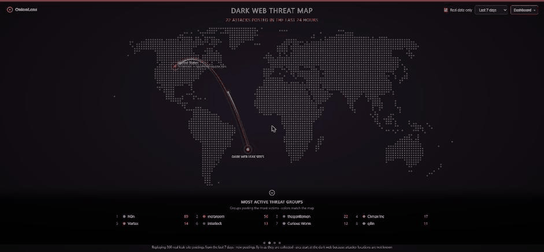
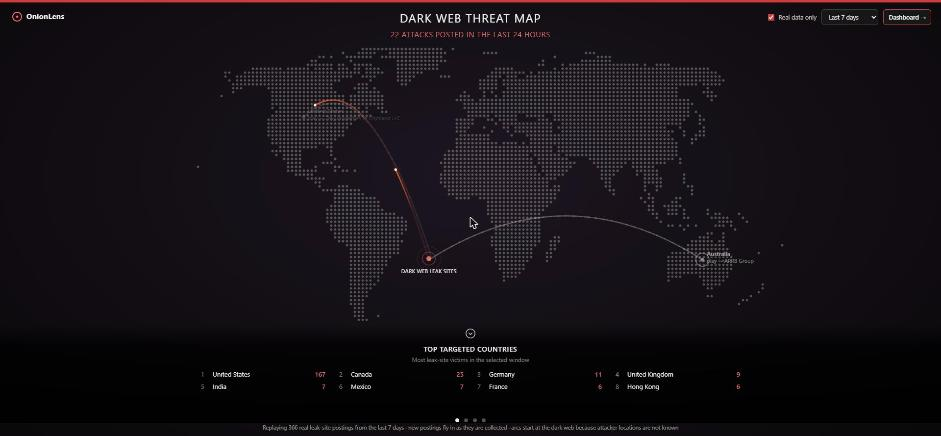
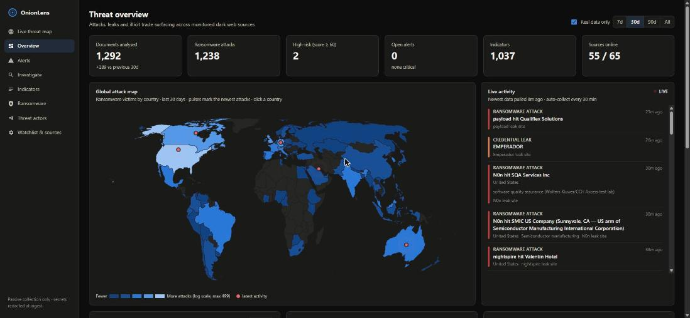
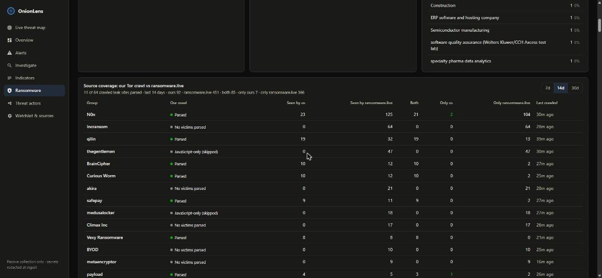
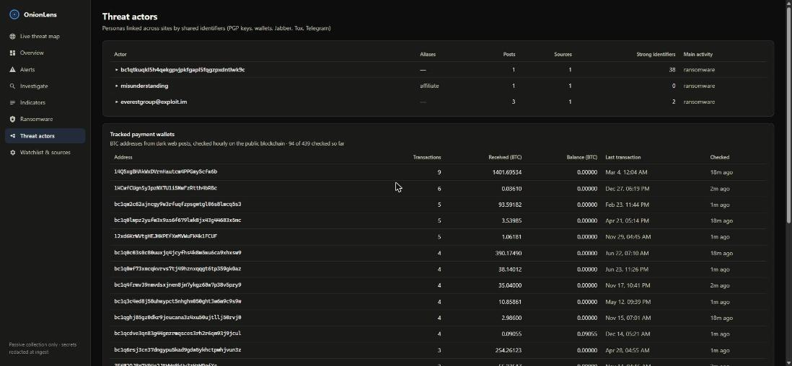
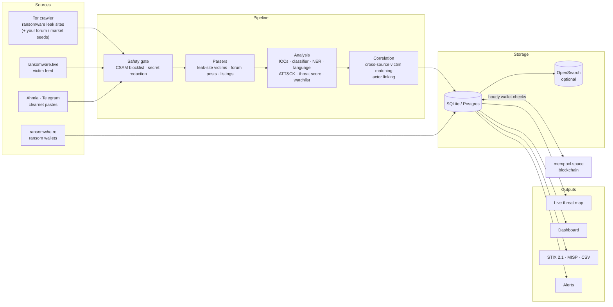

# OnionLens: Dark Web Threat Intelligence Platform

**OnionLens collects, analyses and visualises dark web threat data.** It crawls ransomware leak sites over
Tor, extracts victims and indicators of compromise, links threat-actor personas across sites, tracks ransom
wallets on the blockchain, and shows the results on a live threat map and an analyst dashboard.



**At a glance (real data, collected by this instance):**

| | |
|---|---|
| Ransomware victims tracked | **33,400+** across **388 groups** and **190 countries** (2013 → today) |
| Leak sites crawled directly over Tor | **64** (front pages, text only) |
| Victims extracted by our own parsers, confirmed by an independent source | **97%** (271 of 278 over 30 days) |
| Ransom wallets watched on the blockchain | **439** |
| Classifier accuracy on held-out labelled posts | **89%** (macro-F1 0.90, up from a 61% baseline) |
| Automated tests | **30** |

## Screenshots

| Live threat map | Analyst overview |
|---|---|
|  |  |
| **Ransomware: source coverage, our Tor crawl vs ransomware.live** | **Threat actors and tracked ransom wallets** |
|  |  |

## Architecture



A built-in scheduler runs every collector on its own interval while the server is up. In the Docker stack,
Celery beat does this job instead.

## Data sources

| Source | What it gives | Real? | How often |
|---|---|---|---|
| **Ransomware leak sites, crawled directly over Tor** | Victim postings read from the leak sites' own pages (10 group-specific parsers + a generic fallback) | ✅ real | every 6 h |
| **ransomware.live** | Victim feed covering ~400 groups, used as a third-party baseline | ✅ real | every 30 min |
| **ransomwhe.re** | Bitcoin addresses that received ransom payments, labelled by ransomware family | ✅ real | daily |
| **mempool.space / blockstream.info** | On-chain activity of tracked wallets (automatic fallback if one provider throttles) | ✅ real | hourly |
| Your forum / market seeds | One document per post or listing (XenForo, phpBB, MyBB, SMF, vBulletin) | ✅ real, if you configure them | on demand |
| Ahmia, Telegram, clearnet | Onion search metadata, public channels, pastes | ✅ real, if configured | on demand |
| Demo dataset | Fictional forum posts, personas and victims (`.example` domains) | ❌ synthetic, kept in a separate `data/demo.db` | — |

## Features

| Area | What it does |
|---|---|
| **Live threat map** | The landing page: a full-screen dotted world map. Animated arcs fly to each victim's country, coloured by ransomware group, with a 24-hour attack counter and a rotating panel (top countries, groups, industries, latest attacks). |
| **Leak-site victim parsing** | Extracts the victim's name, domain, date, sector and country from leak-site HTML. Masked or "Redacted" names are skipped. When no country is given, it is inferred from the domain (`.com.br` → Brazil). JavaScript-only sites are detected and skipped, because running attacker JavaScript is unsafe. |
| **Cross-source correlation** | The same victim reported by our crawl and by ransomware.live is merged (normalised names and domains). Each source's sighting is recorded, so the dashboard shows which victims each source missed. |
| **Safety** | CSAM indicators are dropped before anything is stored. Passwords, card numbers and SSNs are **redacted at ingest**, and emails are stored masked. The crawler is text-only: no JavaScript, no downloads, no forms, no logins. |
| **IOC extraction** | 18 types, with validation: credentials, cards (Luhn check), BTC wallets (base58check and bech32 checksums), XMR/ETH wallets, PGP keys, Jabber/Tox/Telegram IDs, .onion addresses, domains, IPs, hashes and CVEs. |
| **Classification** | An explainable keyword classifier (see *Evaluation*), with an optional HuggingFace zero-shot engine. |
| **Watchlist alerts** | Domains, keywords, email domains, IP ranges and card BINs. Leaked credentials, or your organisation appearing as a ransomware victim, raise a **critical** alert. |
| **Actor linking** | A co-occurrence graph of handles, PGP keys, wallets and contacts resolves the same operator across sites, aliases included. |
| **Wallet tracking** | Ransom and payment wallets are checked on the public blockchain. New transactions appear in the live feed. |
| **MITRE ATT&CK** | Content is mapped to techniques, with links to attack.mitre.org. |
| **Exports** | STIX 2.1 (indicators, vulnerabilities, threat actors, attack patterns; TLP:AMBER), MISP and CSV. Masked values are never exported. |

## Evaluation: how accurate is the classifier?

I measured it rather than assuming it works. Run it yourself with `onionlens evaluate`; the full report is in
[`eval/RESULTS.md`](eval/RESULTS.md).

**Method.** [`eval/labeled_posts.jsonl`](eval/labeled_posts.jsonl) holds 98 hand-labelled posts. They cover all
eight threat categories plus hard negatives: security news, a password-manager advert, forum rules and
small talk. The set is split 50/50 (stratified). Classifier changes were guided **only by errors on the dev
half**. The numbers below are on the **untouched test half**.

| Version | Test accuracy | Macro-F1 |
|---|---:|---:|
| v1: original keyword lexicon | 61% | 0.66 |
| v2: richer vocabulary, plural matching, lower commit threshold, news damping | **89%** | **0.90** |

**What the remaining errors look like.** Slang with no category keyword ("anyone got the new combo for
streaming sites?"), fraud described indirectly ("refund service"), and adverts that use threat vocabulary
innocently ("our password manager keeps your logins encrypted").

**Real-world check.** On 33 real leak-site front pages collected over Tor, the text classifier alone recognises
only 9 as ransomware (27%). Leak sites are mostly lists of company names with little extortion vocabulary. So
OnionLens labels pages from known leak sites **by source**, and keeps the text classifier for forum posts,
listings and pastes. A regression test fails if held-out accuracy drops below 85%.

**Caveat.** The labelled set is small and was written for this project, not drawn from a public corpus. Treat
the numbers as a sanity check and a regression guard, not a benchmark.

## Source coverage: our Tor crawl vs ransomware.live

Every victim records which sources reported it, so OnionLens can measure what each source misses. This is the
**Source coverage** table on the Ransomware page. Snapshot over 30 days:

| | Victims |
|---|---:|
| Extracted by our own leak-site crawl | 278 |
| … also reported by ransomware.live | 271 (**97%**) |
| … found **only** by our crawl | 7 |
| Reported only by ransomware.live | 776 |

Of the 64 leak sites crawled, the latest run looked like this:

| Outcome | Sites |
|---|---:|
| Victims parsed | 14 |
| Page only built by JavaScript, skipped on purpose | 12 |
| Offline (onion sites go up and down) | 9 |
| Reachable, but layout not yet supported | 29 |

**Why ransomware.live sees more.** We read only each site's **front page**, roughly the newest 20 postings. A full
archive crawl would need pagination, which is a deliberate trade-off to stay light-touch.

**What the 97% means.** Our parsers' output is independently confirmed, so this works as an accuracy check on the
parsers themselves.

**The 7 crawl-only victims** are recent postings (a hospital, a hotel, a software-QA firm…) that were not in
ransomware.live's data when the snapshot was taken.

## Quick start

```bash
python -m venv .venv
.venv\Scripts\activate                 # Windows  (macOS/Linux: source .venv/bin/activate)
pip install -e ".[dev]"
cd frontend && npm install && npm run build && cd ..

onionlens collect ransomware --limit 4000   # ~6 weeks of real victims, no Tor needed
onionlens serve                             # http://127.0.0.1:8000  (API docs: /docs)
```

If Tor Browser is installed, `onionlens serve` starts its bundled `tor.exe` headless on port 9050. It then crawls
leak sites every 6 hours, refreshes the ransom-wallet list daily and checks wallets hourly. Check the connection
with `onionlens tor-check`.

**Demo instance (fictional data only, kept out of the real database):**

```bash
onionlens --db data/demo.db demo
onionlens --db data/demo.db serve
```

### Commands

| Command | Purpose |
|---|---|
| `onionlens serve` | API + dashboard + background scheduler (+ Tor autostart) |
| `onionlens collect <ransomware\|leaksites\|tor\|ahmia\|telegram\|clearnet\|demo>` | Run one collector through the pipeline |
| `onionlens ransomwhere` / `onionlens wallets` | Import ransom wallets / check wallets on the blockchain |
| `onionlens tor-start` / `onionlens tor-check` | Start the headless Tor client / verify Tor connectivity |
| `onionlens evaluate` | Measure classifier accuracy → `eval/RESULTS.md` |
| `onionlens export <stix\|misp\|csv>` | Export indicators |
| `onionlens purge-demo` | Remove the synthetic dataset from a database |

## Monitoring forums and markets (optional)

Add the sites you are **authorised** to monitor to `config/seeds.yaml` with `type: forum` or `type: market`.
Forum threads are split into individual posts (author, date, text), and markets into listings (title, price,
vendor), so actor linking works per post. For sites that need an account, register it yourself and put the
session cookie in an environment variable referenced by `cookie_env`. OnionLens never logs in, stores
passwords, posts or buys.

## Full stack (Docker)

```bash
docker compose up -d --build     # Postgres, Redis, OpenSearch, Tor, API, Celery worker + beat
docker compose exec api onionlens collect ransomware --limit 4000
```

## How fresh is the data?

Near-real-time, not a live stream. Each source is pulled on its own schedule (table above), and the dashboard
and map poll the API every 30 seconds. A victim appears within one collection interval of being posted.

## Project layout

```
onionlens/
  collectors/    tor_crawler, leaksites, leak_parsers, forum_parsers, htmlblocks,
                 ransomware_live, ahmia, telegram, clearnet, demo
  processing/    ioc, classifier, entities, language, watchlist, scoring, linking
  enrich/        wallets (mempool.space), ransomwhere
  exporters/     stix, misp, attack
  api/main.py    FastAPI REST API (+ serves the built dashboard)
  pipeline.py    ingest → safety → parse → analyse → correlate → store
  scheduler.py   in-process collection schedule    tor_manager.py  headless Tor client
  evaluate.py    classifier evaluation             cli.py          `onionlens` command
frontend/        React + Vite: live threat map (canvas) and table-based dashboard, dark mode
eval/            labelled evaluation set + RESULTS.md
tests/           pytest: IOC validation, redaction, parsers, correlation, pipeline, API, exports, wallets
```

## Ethics and legal scope

OnionLens is a **passive** tool for defensive security research and education.

* It reads public pages only. It never logs in, registers, posts, buys or downloads files, and never runs
  JavaScript from crawled sites.
* Ransomware leak sites are monitored at front-page level only. Leaked files are never fetched.
* CSAM indicators are dropped automatically and are never stored or displayed.
* Credentials and payment data are redacted before storage. The platform records *that* a leak happened,
  not the secrets themselves.
* Laws differ by country. Make sure your collection is authorised before adding sources, and run Tor
  collection in an isolated environment.

## Testing

```bash
pytest -q
```

## License

MIT
